# SEVERIN — System Architecture & Data Flow

SEVERIN (**S**wiss **E**xtraction & **V**erifiable **E**ntity **R**epresentation for Parliamentary **I**nter-cantonal **N**etworks) transforms heterogeneous, multilingual Swiss parliamentary PDF documents into a harmonized, zero-hallucination data representation backed by algorithmic provenance verifiers.

---

## 1. Pipeline Architecture (Mermaid)

```mermaid
flowchart LR
    subgraph S1["1. Ingestion & Preprocessing"]
        API["OpenParlData API<br/>(26 Cantons + CHE)"] --> PDF["PDF Ingestion Engine<br/>(PyPDF 4.x)"]
        LOCAL["National Corpus<br/>(27 Curated PDFs &lt; 20MB)"] --> PDF
        PDF --> TEXT["1-Indexed Page Parser<br/>&amp; Layout Normalizer"]
    end

    subgraph S2["2. Sovereign Supercomputing"]
        TEXT --> PROMPT["Structured Extraction Prompt<br/>+ Pydantic JSON Schema"]
        PROMPT --> CSCS["CSCS Alps Supercomputer<br/>(NVIDIA GH200 Nodes, Lugano)"]
        CSCS --> APERTUS["swiss-ai/Apertus-v1.5-8B<br/>temperature=0.0 (Deterministic)"]
        APERTUS --> CACHE["Alps PagedAttention<br/>Prefix-Cache (4,800+ tokens @ 0.00 CHF)"]
    end

    subgraph S3["3. Schema & Strict Provenance"]
        APERTUS --> NORM["Defensive Normalizer<br/>(Key Hoisting &amp; Q&amp;A Restructure)"]
        NORM --> SCHEMA["Pydantic v2 Unified Schema<br/>extra='forbid' (Zero Hallucination)"]
        SCHEMA --> VERIFIER["Algorithmic Provenance Verifier<br/>(Physical Text Grounding &amp; Char Offsets)"]
    end

    subgraph S4["4. Delivery & Interfaces"]
        VERIFIER --> AUDIT["Machine-Readable Benchmark<br/>(benchmark_results.json)"]
        VERIFIER --> FASTAPI["FastAPI REST Server<br/>(REST &amp; Telemetry)"]
        FASTAPI --> REACT["React 19 Civic Web UI<br/>(Dual View &amp; Citation Chips)"]
    end

    classDef c1 fill:#1e293b,stroke:#38bdf8,stroke-width:2px,color:#f8fafc;
    classDef c2 fill:#1e293b,stroke:#ef4444,stroke-width:2px,color:#f8fafc;
    classDef c3 fill:#1e293b,stroke:#10b981,stroke-width:2px,color:#f8fafc;
    classDef c4 fill:#1e293b,stroke:#8b5cf6,stroke-width:2px,color:#f8fafc;

    class API,PDF,LOCAL,TEXT c1;
    class PROMPT,CSCS,APERTUS,CACHE c2;
    class NORM,SCHEMA,VERIFIER c3;
    class AUDIT,FASTAPI,REACT c4;
```

---

## 2. Core Components

### 2.1 PDF Ingestion & Normalizer (`src/pdf_parser.py`)
- Extracts raw text per physical page preserving strict 1-indexed page numbering matching PDF viewer UI counters.
- Normalizes layout whitespace and line breaks while keeping original casing and punctuation for exact substring provenance searches.
- Defensively handles corrupted embedded fonts and ligature anomalies (e.g. non-printable control characters in historical federal gazettes).

### 2.2 Sovereign CSCS Inference Client (`src/cscs_client.py`)
- Connects directly to `https://api.inference.cscs.ch/v1` on Switzerland's **Alps Supercomputer** (CSCS Lugano).
- Uses `swiss-ai/Apertus-v1.5-8B` with `temperature=0.0` ensuring absolute mathematical determinism.
- Exploits Alps vLLM **PagedAttention prefix caching**, where 4,800+ tokens of shared system schema are served directly from GPU high-bandwidth memory at **0.000000 CHF**.
- Audits token consumption and micro-tariffs (`0.01 CHF / 1M input`, `0.04 CHF / 1M output`), logging every call to `data/telemetry.json`.

### 2.3 Unified Representation Schema (`src/schema.py`)
- Standardized across all 4 Swiss language regions (DE, FR, IT, RM) and 3 governance tiers (Federal, Cantonal, Municipal).
- Strictly enforces `extra="forbid"`, completely preventing LLM extrapolations or invented fields.
- Harmonizes 8 core affair types: `motion`, `postulate`, `interpellation`, `question`, `initiative`, `government_affair`, `petition`, and `other`.

### 2.4 Algorithmic Provenance Verifier (`src/extractor.py`)
- Every extracted field (title, author, rationale, questions, answers, financial credits) requires a `Provenance` block specifying the 1-indexed page number and verbatim text quote.
- The verifier performs exact substring locating, computing character offsets (`char_start`, `char_end`) within the physical document text.
- Fallback page relocation detects whether the LLM cited an adjacent page, adjusting offsets and setting status to `inferred`.
- If an extracted quote does not physically exist in the source document, it is deterministically tagged as `not_found`, driving down the provenance match score.

### 2.5 Cross-Cantonal Benchmark Engine (`src/benchmark.py`)
- Evaluates extraction across federal and cantonal jurisdictions:
  - **CHE**: Federal Initiative (German)
  - **ZH**: Cantonal Postulate (German)
  - **GE**: Cantonal Written Question (French)
  - **TI**: Cantonal Interpellation (Italian)
  - **GR**: Cantonal Inquiry (Trilingual German/Italian/Romansh)
- Supports both **Live CSCS Alps mode** and **Offline Dry-Run mode** (using physical PDFs and validated cache for zero-network jury evaluation).
