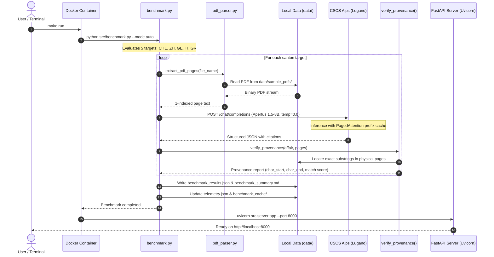
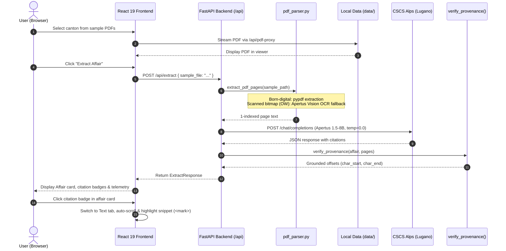
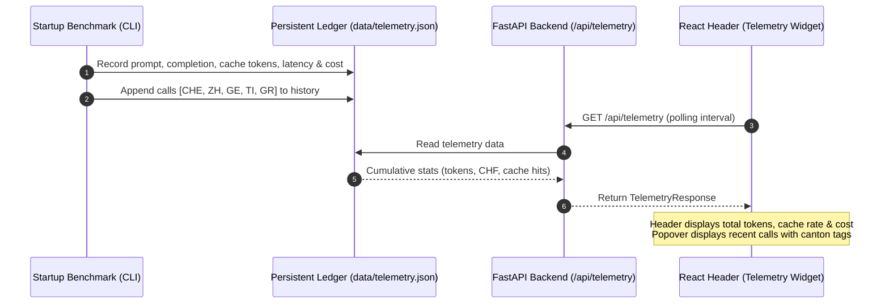

# SEVERIN — System Architecture & Data Flow

SEVERIN (**S**wiss **E**xtraction & **V**erifiable **E**ntity **R**epresentation for Parliamentary **I**nter-cantonal **N**etworks) transforms heterogeneous, multilingual Swiss parliamentary PDF documents into a structured schema with page-anchored provenance verification.


---

## 1. Pipeline Architecture

```mermaid
flowchart LR
    subgraph S1["1. Ingestion & Preprocessing"]
        API["OpenParlData API<br/>(Cantons + Federal)"] --> PDF["PDF Ingestion<br/>(pypdf)"]
        LOCAL["Sample Corpus<br/>(27 Curated PDFs)"] --> PDF
        PDF --> DETECT{"Text Layer Check<br/>char_count > 0?"}
        DETECT -- Yes: Digital PDF --> TEXT["1-Indexed Page Parser<br/>&amp; Swiss Normalizer"]
        DETECT -- No: Raster Scan --> OCR["Pillow Extraction &amp;<br/>Apertus Vision OCR"]
        OCR --> CACHE_OCR[("Disk OCR Cache<br/>data/ocr_cache/")]
        CACHE_OCR --> TEXT
    end

    subgraph S2["2. Model Inference"]
        TEXT --> PROMPT["Extraction Prompt<br/>+ Pydantic JSON Schema"]
        PROMPT --> CSCS["CSCS Inference API<br/>(Alps GH200, Lugano)"]
        CSCS --> APERTUS["swiss-ai/Apertus-v1.5-8B<br/>temperature=0.0"]
        APERTUS --> CACHE["vLLM PagedAttention<br/>Prefix Cache (4,480 toks)"]
    end

    subgraph S3["3. Schema & Provenance"]
        APERTUS --> NORM["Defensive Normalizer<br/>(JSON Idiosyncrasy Repair)"]
        NORM --> SCHEMA["Pydantic v2 Schema<br/>extra='forbid'"]
        SCHEMA --> VERIFIER["Provenance Verifier<br/>(Physical Offsets: start/end)"]
    end

    subgraph S4["4. Delivery & Interfaces"]
        VERIFIER --> AUDIT["Benchmark Outputs<br/>(JSON &amp; Markdown Summary)"]
        VERIFIER --> FASTAPI["FastAPI Backend<br/>(REST &amp; Telemetry)"]
        FASTAPI --> REACT["React 19 Web UI<br/>(Split View &amp; Citations)"]
    end

    classDef c1 fill:#1e293b,stroke:#38bdf8,stroke-width:2px,color:#f8fafc;
    classDef c2 fill:#1e293b,stroke:#ef4444,stroke-width:2px,color:#f8fafc;
    classDef c3 fill:#1e293b,stroke:#10b981,stroke-width:2px,color:#f8fafc;
    classDef c4 fill:#1e293b,stroke:#8b5cf6,stroke-width:2px,color:#f8fafc;

    class API,PDF,LOCAL,DETECT,TEXT,OCR,CACHE_OCR c1;
    class PROMPT,CSCS,APERTUS,CACHE c2;
    class NORM,SCHEMA,VERIFIER c3;
    class AUDIT,FASTAPI,REACT c4;
```



---

## 2. Core Components

### 2.1 PDF Ingestion & Parsing (`src/pdf_parser.py`)
- **Digital PDF Extraction**: Extracts raw text per physical page using `pypdf`, preserving strict 1-indexed page numbering that aligns directly with PDF viewers.
- **Multilingual Swiss Normalization**: Expands ligatures (`fi`, `fl`, `œ`, `æ`), strips non-printable ASCII control artifacts, and maps legacy Type-1/CP1252 embedded font glyphs (`\x11` -> `š`, `\x12` -> `č`).
- **Native Vision OCR Fallback**: For scanned raster documents with 0 extractable digital characters (e.g. Canton Obwalden `OW_339491_925376.pdf`), automatically extracts full-page bitmap images via `Pillow`, optimizes resolution (max 2048px Lanczos), and transcribes via `swiss-ai/Apertus-v1.5-8B` Vision on CSCS Alps (`image_url` input at `temperature=0.0`).
- **OCR Cache**: Persists transcribed text with 1-indexed page markers in `data/ocr_cache/{pdf_name}.json` for instant, deterministic offline replay.

### 2.2 CSCS Inference Client (`src/cscs_client.py`)
- Connects to the OpenAI-compatible CSCS Alps endpoint (`https://api.inference.cscs.ch/v1`).
- Uses `swiss-ai/Apertus-v1.5-8B` with `temperature=0.0` for deterministic outputs.
- Leverages vLLM PagedAttention prefix caching on Alps GPU memory: shared prompt instructions and schema tokens (~4,800 tokens) are cached, reducing inference latency and cost.
- Logs token consumption, cache hits, latency, and estimated CHF expenditure to `data/telemetry.json`.

### 2.3 Unified Representation Schema (`src/schema.py`)
- Pydantic v2 data model (`ParliamentaryAffair`) standardizing affairs across DE, FR, IT, and RM.
- Enforces `extra="forbid"` to reject unmapped or hallucinated keys.
- Harmonizes 8 core affair types: `motion`, `postulate`, `interpellation`, `question`, `initiative`, `government_affair`, `petition`, and `other`.
- Maps conceptually to established standards: *Popolo* (actors, organizations), *Akoma Ntoso* (procedural events, lifecycle), and *Parla-CLARIN* (question/answer pairings).

### 2.4 Provenance Verifier (`src/extractor.py`)
- Every extracted field requires a `Provenance` block specifying the 1-indexed page number and verbatim text quote.
- Locates exact substrings on the cited physical page and computes character offsets (`char_start`, `char_end`).
- If a quote appears on an adjacent page, the verifier updates the page number and flags status as `inferred`.
- If a quote cannot be located in the text, it is tagged as `not_found`, reducing the provenance match score.

### 2.5 Benchmark Engine (`src/benchmark.py`)
- Evaluates extraction across federal and cantonal jurisdictions:
  - **CHE**: Federal Initiative (German)
  - **ZH**: Cantonal Postulate (German)
  - **GE**: Cantonal Written Question (French)
  - **TI**: Cantonal Interpellation (Italian)
  - **GR**: Cantonal Inquiry (Trilingual German/Italian/Romansh)
- Supports both **Live mode** (via CSCS Alps API key) and **Offline Dry-Run mode** (verifying pre-computed completions against physical PDF text with zero network calls).

---

## 3. End-to-End Execution Workflows

### 3.1 Workflow A: Automated Benchmark (`make run`)

When executing `make run`, the container mounts `./data:/app/data`, runs the benchmark, and starts the server:

```
[ Terminal: make run ]
         │
         ▼
[ Docker initializes container: severin_track_2a ]
         │
         ▼
[ benchmark.py selects 5 targets: CHE, ZH, GE, TI, GR ]
         │
         ▼
[ pdf_parser.py extracts 1-indexed page text from data/sample_pdfs/*.pdf ]
         │
         ▼
[ prompts.py builds prompt with Rule of Absence + JSON Schema ]
         │
         ▼ (HTTPS POST to CSCS API)
[ CSCS Alps: Apertus 1.5-8B (temperature=0.0) ]
         │
         ▼ (Structured JSON completion received)
[ extractor.py: verify_provenance() matches substrings against PDF text ]
         │
         ▼
[ Persists artifacts to data/ ]
  ├── data/benchmark_summary.md       (Markdown summary table)
  ├── data/benchmark_results.json     (Per-canton metrics: latency, tokens, citations)
  ├── data/telemetry.json             (CSCS token and cost audit log)
  └── data/benchmark_cache/*.pdf.json (Model outputs for dry-run validation)
         │
         ▼
[ Starts FastAPI server on port 8000: http://localhost:8000 ]
```

#### Sequence Diagram (Benchmark Execution):



---

### 3.2 Workflow B: Interactive Web Application (`http://localhost:8000`)

```
[ User opens http://localhost:8000 ]
         │
         ▼
[ Selects canton from 27 sample PDFs ]
         │
         ▼
[ Clicks "Extract Affair" ]
         │
         ▼ (HTTP POST /api/extract)
[ FastAPI / pdf_parser extracts page text ]
  ├── Born-digital PDFs: pypdf physical page text extraction
  └── Scanned bitmaps (OW): Apertus 1.5-8B Vision OCR fallback
         │
         ▼ (HTTPS POST to CSCS API)
[ Apertus 1.5-8B extracts entities and quote snippets ]
         │
         ▼
[ Verifier validates offsets against physical page text ]
         │
         ▼
[ React 19 UI renders results ]:
  ├── Affair metadata card (title, authors, summary, dates)
  ├── Question & Answer list with verification badges
  ├── Dual-mode Document Studio (raw PDF embed & Text viewer with <mark> citation highlights)
  └── CSCS telemetry bar (tokens, cost, speed)
```

#### Sequence Diagram (Interactive Extraction):



---

### 3.3 Telemetry & Frontend Synchronization (`telemetry.json`)

SEVERIN maintains a unified telemetry log (`data/telemetry.json`) connecting CLI benchmarks, API extractions, and the web interface:



1. **CLI-to-Web Handover**: The 5 benchmark documents processed during container launch (`make run`) are logged to `data/telemetry.json`. When the web UI opens, these calls appear in the telemetry popover with their latencies, token counts, and provenance scores.
2. **Single Source of Truth**: `CSCSInferenceClient` coordinates telemetry logging across both CLI runs and HTTP endpoints, keeping terminal and UI numbers consistent.
3. **Execution Modes**:
   - In **LIVE mode** (with `CSCS_INFERENCE_API_KEY`): Dispatches requests to CSCS Alps, updates token counters, and logs CHF costs.
   - In **OFFLINE DRY-RUN mode** (without API key): Validates pre-computed completions against physical PDF pages. No API requests or costs are recorded, and existing telemetry remains unchanged.
